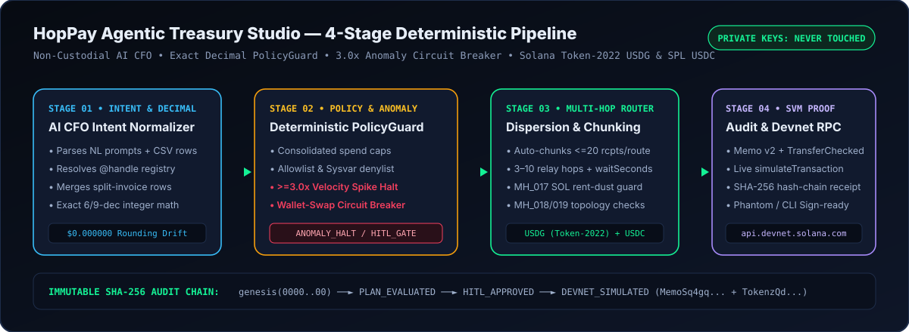
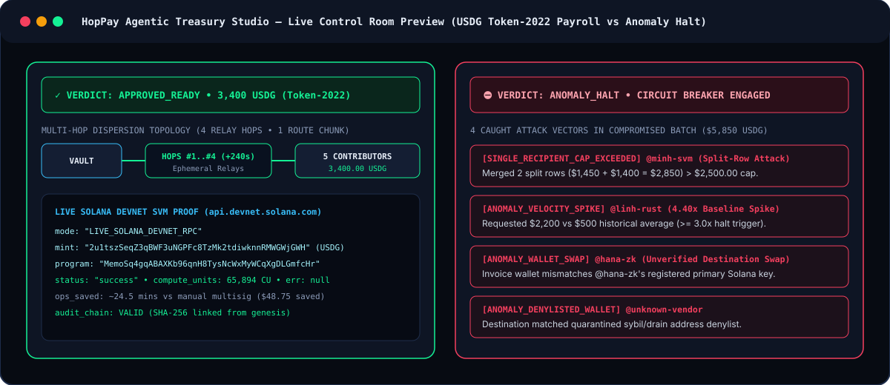
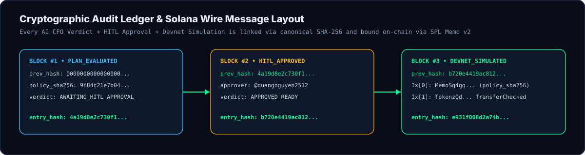

# HopPay Agentic Treasury Studio (`v1.0.0`)

**Autonomous Solana AI CFO, Deterministic Policy & Anomaly Circuit Breaker, and Multi-Hop `USDG` (`Token-2022`) / `USDC` Dispersion Console.**

Built by **Nguyen Quang (`@quangnguyen2512`, Vietnam)** — Open-Source Repository: [`quangnguyen2512/hoppay-treasury`](https://github.com/quangnguyen2512/hoppay-treasury).





---

## Why This Exists

Solana DAOs, hackathon collectives, and AI agent treasuries increasingly automate contributor bounty payouts in **USDG** (`2u1tszSeqZ3qBWF3uNGPFc8TzMk2tdiwknnRMWGWjGWH`, Token-2022) and **USDC** (`EPjFWdd5AufqSSqeM2qN1xzybapC8G4wEGGkZwyTDt1v`, SPL Token). Giving an LLM raw signing authority or unguarded CSV payout execution creates four real failure modes:
1. **Split-Invoice Cap Evasion:** Splitting `$2,850` into `$1,450 + $1,400` rows to bypass a `$2,500` single-recipient spend cap.
2. **Compromised Contributor DM / Wallet Swaps:** An attacker impersonating a contributor handle (`@hana-zk`) and swapping their payout wallet last minute.
3. **Silent Velocity Spikes & Float Drift:** IEEE-754 float errors on 6/9-decimal base units or a `4.4x` anomalous payout spike slipping past manual spreadsheet review.
4. **On-Chain Treasury Graph Leakage:** Paying 25+ contributors directly from the main vault exposes every contributor's salary history and vault schedule publicly.

**HopPay Agentic Treasury Studio** solves all four with a strictly **non-custodial**, deterministic 4-stage pipeline:
- **Exact `Decimal` Base-Unit Consolidation:** Merges duplicate wallets *before* evaluating per-recipient caps (`$0.000000` rounding drift).
- **Deterministic `PolicyGuard` & `ANOMALY_HALT` Circuit Breaker:** Enforces contributor allowlists, Solana protocol-reserved/sybil denylists, registered wallet-swap halts, and `>= 3.0x` rolling baseline velocity halts.
- **Multi-Hop Dispersion Router:** Auto-partitions `> 20` recipients into uniform MultiHopper-compatible dispersion routes (`<= 20` destinations/route, `3–10` hops, `MH_017` SOL rent-exempt guard, `MH_018` loop/reserved-hop checks, `MH_019` devnet bundle guard).
- **Real Solana Wire & Live Devnet SVM Proof:** Compiles spec-exact unsigned Solana legacy transactions (`SPL Memo v2` + `Token-2022` / `SPL` `TransferChecked`) and executes live unsigned `simulateTransaction` verification against `https://api.devnet.solana.com`, chaining every verdict into a tamper-evident **SHA-256 Audit Ledger**.



---

## 1-Command Local Quickstart

```bash
git clone https://github.com/quangnguyen2512/hoppay-treasury.git
cd hoppay-treasury
pip install -r requirements.txt && python app.py
```

Open **`http://127.0.0.1:8090`** in your browser.
- Click between the **3 Live Scenario Cards** (*Clean Token-2022 USDG Payroll*, *Adversarial Split-Invoice + Wallet Swap Halt*, *26-Builder Auto-Chunked Grant Wave*).
- Click **`◎ Verify on Solana Devnet RPC`** to execute a live unsigned `simulateTransaction` on `https://api.devnet.solana.com` and inspect real SVM compute units & `MemoSq4gq...` program logs.

---

## Run Automated Test Suite (`pytest`)

```bash
pytest -v
```

Covers Base58 32-byte pubkey roundtrips, exact `Decimal` math, split-invoice cap evasion blocking, `3.0x` velocity & wallet-swap `ANOMALY_HALT`, 26-wallet uniform auto-chunking, `MH_017`/`MH_018`/`MH_019` route guards, binary `Token-2022` `TransferChecked` wire assembly, SHA-256 tamper detection, Devnet simulation, and FastAPI E2E security gates (`HTTP 409` on halted approval attempts).

---

## 1-Minute Cloud Deployment (3 Zero-Config Options)

1. **GitHub Pages (Zero-Backend Isomorphic Mode — `https://quangnguyen2512.github.io/hoppay-treasury/`):**
   Enable **Settings -> Pages -> Deploy from `main` (`/ (root)`)**. Root `index.html` routes directly to `static/index.html`, which includes an isomorphic client-side policy/hash-chain engine + direct browser Solana Devnet JSON-RPC verification.
2. **Vercel (`vercel.json` included):**
   ```bash
   npx vercel --prod
   ```
3. **Render (`render.yaml` included):**
   Connect `quangnguyen2512/hoppay-treasury` on Render -> **New Blueprint Instance** -> auto-deploys Python FastAPI + `/api/health`.
